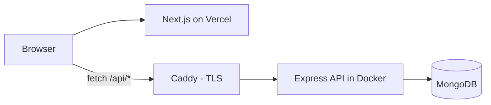

# Versus: a cheatsheet for EA Sports UFC 4 & 5

Pick two fighters and see who has the edge. Versus puts their stats and perks side by side, lists every move they have, and lets you add or edit fighters.

<!-- TODO: live demo link -->
<!-- TODO: screenshot of the compare view, e.g.  -->

## Features

- **Head-to-head comparison.** Choose a weight class and a fighter for each corner to compare stand-up, grappling and health stats and perks.
- **Fighter roster.** Browse all 390 fighters by weight class.
- **Move lists.** See each fighter's punches, kicks, clinch, takedowns, ground game, submissions and combos, with the level of each move.
- **Create, edit and delete fighters** through a seven-step form wizard.

## Tech stack

| Layer    | Tech |
| -------- | ---- |
| Frontend | Next.js 13, React 18, TypeScript, TanStack Query, react-hook-form, Tailwind CSS |
| Backend  | Node 22, Express, Mongoose, TypeScript (bundled with esbuild) |
| Database | MongoDB |
| Hosting  | Vercel (client); Docker on a VPS behind Caddy (API); GitHub Actions + GHCR |



The frontend and the API share one `Fighter` type from `shared/types.ts`, so both sides agree on the data shape at compile time.

## Quick start

```bash
npm install
cp server/.env.example server/.env
echo "NEXT_PUBLIC_API_URI=http://localhost:5000/api" > client/.env.local
npm run dev --workspace=server   # API on :5000, seeds the DB on first run
npm run dev --workspace=client   # app on :3000
```

You need Node 22 and a MongoDB instance. See [Getting started](docs/getting-started.md) for the details.

## Documentation

- [Getting started](docs/getting-started.md)
- [Architecture](docs/architecture.md)
- [API reference](docs/api.md)
- [Configuration](docs/configuration.md)
- [Data and seeding](docs/data-and-seeding.md)
- [Deployment](docs/deployment.md)
- [Decision records](docs/decisions/)

## Background

This is a TypeScript and Next.js rewrite of an [earlier vanilla-JS version](https://github.com/yoyanni/versus/tree/add-backend).
