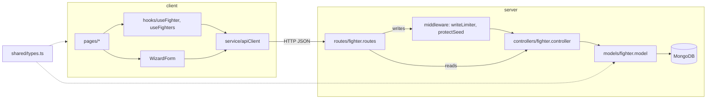

# Architecture

```
client/   Next.js 13 (Pages Router), TanStack Query, react-hook-form, Tailwind   → Vercel
server/   Express + Mongoose, ESM; tsx in dev, esbuild bundle in prod           → Docker on VPS
shared/   types.ts: the Fighter type both sides compile against; limits.ts: constants both sides run
```



## Shared types and path aliases

`tsconfig.base.json` defines `@shared/*` → `shared/*` and `@/*` → `client/src/*`, and both workspaces extend it. esbuild resolves the aliases when it bundles the server.

`shared/limits.ts` is imported as a value, not just a type, which needs two things:

- `experimental.externalDir` in `client/next.config.js`. Without it, Next doesn't compile TypeScript outside `client/`.
- `shared/package.json` with `"type": "module"`. Without it, `tsx` loads the folder as CommonJS and the server's `dev` and `seed` scripts fail on the import.

## Pages

| Route | File | What it shows |
| --- | --- | --- |
| `/` | `pages/index.tsx` | Compare view: two fighter cards and the weight-class/fighter picker (`Versebar`) |
| `/fighters` | `pages/fighters/index.tsx` | All fighters, grouped by weight class in accordions |
| `/fighters/:id` | `pages/fighters/[id]/index.tsx` | Fighter details, stats and moves. Edit and delete buttons for sandbox fighters only |
| `/fighters/new` | `pages/fighters/new.tsx` | The wizard in create mode, with a note about the sandbox |
| `/fighters/:id/edit` | `pages/fighters/[id]/edit.tsx` | The wizard in edit mode, or a read-only message for a seed fighter |

`pages/api/hello.ts` is leftover Next.js boilerplate. The real API is the Express server.

Every page is wrapped in `components/Layout.tsx`. Its header (the nav and the bar under it) is sticky on every screen size, with `z-30`: above page content and the `Versebar`'s fighter list (`z-20`), below `ConfirmDialog` (`z-50`). The bar under the nav shows the weight-class group that is live this hour and a countdown to the next one. `hooks/useRotation.ts` derives both from the clock: the group is `standard.weightClassRotation[epochHour % 5]`, and it changes at the top of each hour. Nothing is stored, so the order of that array is what fixes which group is live. The hook returns `null` until the component mounts, to keep the server render and the first client render the same.

## Client data flow

- **`service/apiClient.ts`** is a thin `fetch` wrapper (`get`, `post`, `put`, `delete`). On a non-2xx response it throws an error carrying the server's `message`.
- **Reads** go through TanStack Query hooks: `useFighters()` uses the key `["fighters"]` and `useFighter(id)` uses `["fighter", id]`. Both have a 5-minute `staleTime`.
- **Writes** call `apiClient` directly (there's no `useMutation`), then invalidate those query keys by hand.
- **The home page stores only IDs**: the weight class and a fighter ID per corner, or `null` for a corner nobody has picked. `utils/pickCorners.ts` resolves them on every render. A `null` corner, or one whose fighter is no longer in the list, gets the highest-ranked fighter in the weight class that the other corner isn't showing, seed fighters first (see [Data and seeding](data-and-seeding.md#default-fighters-on-the-home-page)). `Versebar` is always rendered, with or without two fighters.
- **Seed fighters are read-only.** The pages compare `fighter._id` with `SANDBOX_ID_START` to decide whether to show the edit and delete controls. The client never sends the admin token.

## Server write flow

`POST`, `PUT` and `DELETE` pass through middleware before the controller (see [API](api.md#who-can-write)):

1. `express.json({ limit: "16kb" })` rejects oversized bodies.
2. `middleware/writeLimiter.ts` allows 20 writes per 30 minutes per IP and skips requests with a valid admin token.
3. `middleware/protectSeed.ts` (`PUT` and `DELETE` only) returns `403` for a seed fighter unless the admin token is sent.
4. `createFighter` gives the new fighter a sandbox ID and evicts the oldest sandbox fighters beyond the cap of 3.

## The fighter wizard

`components/WizardForm.tsx` handles both create and edit. Passing a `fighter` prop switches it to edit mode.

- **Steps are data.** `config/formConfig.ts` exports `wizardSteps` (General Info, Basic Info, Perks, Stand-Up, Grappling, Health, Moves), and `FormStepRender` renders them. Each input's `id` is a react-hook-form `FieldPath` into `FighterForm`.
- **`FighterForm` is not `Fighter`:**
  - identity fields sit under `generalInfo`
  - `basic` becomes `basicInfo`
  - `perks` holds only perk names, and the full perk objects are rebuilt from `standard.perks` on submit
  - a temporary `move` field holds the move being added
- **A select option can have a label that differs from its value.** Plain `options` are strings, or `{ value, option }` objects where `option` is the label. The rank select uses the second form: its values are `"0"` to `"15"` and its labels come from `utils/formatRank.ts`. A new fighter starts on "Unranked".
- **Move values are encoded** as `"<path>:<name>"`, for example `"ground.sweeps:BJJ"`. `WizardForm` splits the selected value on `:`, and `getMoves` turns the path into the `moves.*` array to read and write.
- **Levels and stats use different lists.** The four level selects (Basic Info, Stand-Up, Grappling, Health) offer 1.5 to 5 in half steps. The skill selects under them offer 79 to 100. Both lists are generated in `formConfig.ts` from the bounds in `shared/limits.ts`.
- **Validation is per step.** Each input's `rules` in `formConfig.ts` are passed to `register`, and `FormStepRender` shows the error under the field. Only the current step's fields are mounted, and `handleSubmit` skips fields that aren't, so "Forth" (`goForth`) runs `trigger` on the current step and stays put if anything is invalid. Only the Forth/Submit button moves on: the form's `onSubmit` only calls `preventDefault`, so Enter in a field does nothing, and Submit calls `handleSubmit(onSubmit)()` directly. The form uses `mode: "onChange"`, so an error clears as soon as the field is fixed.
- **Numbers are numbers.** Numeric fields are registered with `valueAsNumber`. Level, stat and move-level selects use `0` as their placeholder value (and `createFighterForm` starts them at `0`), and a `min` rule rejects it. An empty reach is `NaN`, which `required` rejects.
- **Perks are capped at 5** (`MAX_PERKS`). Once 5 are picked the other options are disabled, and a rule catches a sixth picked by a range selection.
- **Moves.** Moves already added are left out of the move select (`FormStepRender`'s `hiddenOptions`), and a group with nothing left is hidden. "Add move" is disabled until a move and a level are chosen. Adding a move resets the move and level selects and opens the move's group (for a ground move, Ground and its subgroup). `MoveAccordion` renders only the move groups. The wizard shows them at the top level, since the step is already called Moves. The fighter page wraps them in its own Moves accordion, next to Stats, and passes `nested`, which indents every level one step further. The wizard passes `MoveAccordion` an `editing` prop: each row then gets a level select and a remove button, and the wizard controls which groups are open (`ChildAccordion` takes `isOpen` and `onToggle`). Without `editing`, as on the fighter page, the rows show the level as text and each group opens on its own.
- `mapper/createFighterForm.ts` builds the form's default values, from a fighter in edit mode or empty in create mode.

## Styling

Tailwind theme tokens (`redCorner`, `blueCorner`, `primaryFontSize`, …) map to CSS variables in `client/src/styles/globals.css`. Tailwind can't see class names that are built at runtime, such as the wizard stepper's `` bg-[${color}] ``, so those must be listed in `safelist` in `client/tailwind.config.ts`.

### Breakpoints

The design is mobile-first. Unprefixed classes are the phone layout, and `theme.screens` in `client/tailwind.config.ts` replaces Tailwind's defaults with two breakpoints (see [ADR 0004](decisions/0004-two-named-breakpoints.md)):

| Prefix | From | Typical devices |
| --- | --- | --- |
| none | 0 | Phones |
| `tablet:` | 768px | Tablets, including iPads in landscape |
| `desktop:` | 1280px | Laptops and desktops |

`sm:`, `md:`, `lg:`, `xl:` and the `max-w-screen-*` utilities don't exist. `future.hoverOnlyWhenSupported` limits `hover:` styles to devices with a pointer that can hover, so a tap on a phone doesn't leave a hover colour behind.

`#__next` is a flex column and each page renders its own `<main>`, so each page sets its own width with `w-full mx-auto` and a `max-w-*`. The header lines up with the widest page (`max-w-7xl`) while its background stays full width.

While a page's data loads, it returns `components/Loading.tsx` instead of its content. Loading renders its own `<main>` (with `grow`, so it fills the space under the header) and centres a red and blue spinner with a label such as "Loading fighters…". It fades in after 300 ms (the `delayedFadeIn` animation in `client/tailwind.config.ts`), so a fast or cached load doesn't flash it. The spinning and the fade are `motion-safe:`, so with reduced motion it shows straight away and doesn't spin.

| Page | Tablet | Desktop |
| --- | --- | --- |
| Compare (`/`) | Picker above the cards. Cards in 2 columns (CSS `columns`, so cards of different heights pack without gaps) | Same 2 columns, `max-w-7xl` |
| Fighter list | `max-w-3xl`; an open weight class lists its fighters in 2 columns, split by a 1px `column-rule` that fills a 1px `column-gap` (a rule in a zero gap would sit under the striped rows' backgrounds). The stripes follow each fighter's row in its column, worked out from `ceil(count / columns)` per breakpoint, so they line up across columns | `max-w-5xl`, 3 columns |
| Fighter details | `max-w-3xl`; the info rows in 2 columns, the accordions in a bordered box | `max-w-6xl`; the info stays on the left (sticky at `top-20`, just under the header), the accordions take the right two thirds |
| Wizard | `max-w-xl` | Same as tablet |

The `Versebar` (the picker) is fixed to the bottom of the screen on phones. From tablet up it's a row above the cards that scrolls with the page: red corner, weight class, blue corner. Its lists drop down over the cards (`z-20`): the weight classes under their button, a corner's fighters across the whole row. In both placements only one list is open at a time. The home page renders it twice, `placement="top"` before the cards and `placement="bottom"` after them, and each hides itself at the other sizes. The bottom bar has to come after the cards because it has no `z-index` and paints over them only through DOM order.

## Server startup

`server.ts` validates the env (by importing `config/env.ts`), connects to MongoDB (and exits if the first attempt fails), seeds the collection if it's empty, then listens. After startup, a dropped connection is retried every 3 s. On SIGINT or SIGTERM, `disconnectDB()` closes the connection without triggering that retry, and the process exits.
