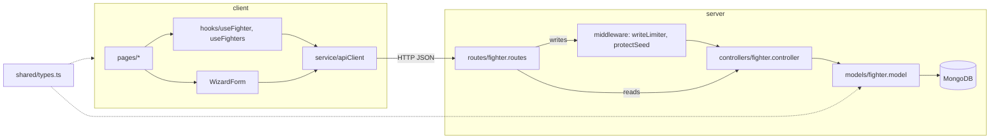

# Architecture

```
client/   Next.js 13 (Pages Router), TanStack Query, react-hook-form, Tailwind   → Vercel
server/   Express + Mongoose, ESM; tsx in dev, esbuild bundle in prod           → Docker on VPS
shared/   types.ts: the Fighter type both sides compile against; limits.ts: constants both sides run
```



## Shared types and path aliases

`tsconfig.base.json` defines `@shared/*` → `shared/*` and `@/*` → `client/src/*`, and both workspaces extend it. esbuild resolves the aliases when it bundles the server.

`shared/limits.ts` is imported as a value, not just a type, which needs two things:

- `experimental.externalDir` in `client/next.config.js`. Without it, Next doesn't compile TypeScript outside `client/`.
- `shared/package.json` with `"type": "module"`. Without it, `tsx` loads the folder as CommonJS and the server's `dev` and `seed` scripts fail on the import.

## Pages

| Route | File | What it shows |
| --- | --- | --- |
| `/` | `pages/index.tsx` | Compare view: two fighter cards and the weight-class/fighter picker (`Versebar`) |
| `/fighters` | `pages/fighters/index.tsx` | All fighters, grouped by weight class in accordions |
| `/fighters/:id` | `pages/fighters/[id]/index.tsx` | Fighter details, stats and moves. Edit and delete buttons for sandbox fighters only |
| `/fighters/new` | `pages/fighters/new.tsx` | The wizard in create mode, with a note about the sandbox |
| `/fighters/:id/edit` | `pages/fighters/[id]/edit.tsx` | The wizard in edit mode, or a read-only message for a seed fighter |

`pages/api/hello.ts` is leftover Next.js boilerplate. The real API is the Express server.

Every page is wrapped in `components/Layout.tsx`. The bar under its nav shows the weight-class group that is live this hour and a countdown to the next one. `hooks/useRotation.ts` derives both from the clock: the group is `standard.weightClassRotation[epochHour % 5]`, and it changes at the top of each hour. Nothing is stored, so the order of that array is what fixes which group is live. The hook returns `null` until the component mounts, to keep the server render and the first client render the same.

## Client data flow

- **`service/apiClient.ts`** is a thin `fetch` wrapper (`get`, `post`, `put`, `delete`). On a non-2xx response it throws an error carrying the server's `message`.
- **Reads** go through TanStack Query hooks: `useFighters()` uses the key `["fighters"]` and `useFighter(id)` uses `["fighter", id]`. Both have a 5-minute `staleTime`.
- **Writes** call `apiClient` directly (there's no `useMutation`), then invalidate those query keys by hand.
- **Seed fighters are read-only.** The pages compare `fighter._id` with `SANDBOX_ID_START` to decide whether to show the edit and delete controls. The client never sends the admin token.

## Server write flow

`POST`, `PUT` and `DELETE` pass through middleware before the controller (see [API](api.md#who-can-write)):

1. `express.json({ limit: "16kb" })` rejects oversized bodies.
2. `middleware/writeLimiter.ts` allows 20 writes per 30 minutes per IP and skips requests with a valid admin token.
3. `middleware/protectSeed.ts` (`PUT` and `DELETE` only) returns `403` for a seed fighter unless the admin token is sent.
4. `createFighter` gives the new fighter a sandbox ID and evicts the oldest sandbox fighters beyond the cap of 3.

## The fighter wizard

`components/WizardForm.tsx` handles both create and edit. Passing a `fighter` prop switches it to edit mode.

- **Steps are data.** `config/formConfig.ts` exports `wizardSteps` (General Info, Basic Info, Perks, Stand-Up, Grappling, Health, Moves), and `FormStepRender` renders them. Each input's `id` is a react-hook-form `FieldPath` into `FighterForm`.
- **`FighterForm` is not `Fighter`:**
  - identity fields sit under `generalInfo`
  - `basic` becomes `basicInfo`
  - `perks` holds only perk names, and the full perk objects are rebuilt from `standard.perks` on submit
  - a temporary `move` field holds the move being added
- **Move values are encoded** as `"<path>:<name>"`, for example `"ground.sweeps:BJJ"`. `handleMoveAddition` splits on `:` to find which `moves.*` array to append to.
- **Levels and stats use different lists.** The four level selects (Basic Info, Stand-Up, Grappling, Health) offer `standard.levels` (1.5 to 5). The skill selects under them offer `standard.stats` (79 to 100).
- `mapper/createFighterForm.ts` builds the form's default values, from a fighter in edit mode or empty in create mode.

## Styling

Tailwind theme tokens (`redCorner`, `blueCorner`, `primaryFontSize`, …) map to CSS variables in `client/src/styles/globals.css`. Tailwind can't see class names that are built at runtime, such as the wizard stepper's `` bg-[${color}] ``, so those must be listed in `safelist` in `client/tailwind.config.ts`.

## Server startup

`server.ts` validates the env (by importing `config/env.ts`), connects to MongoDB (and exits if the first attempt fails), seeds the collection if it's empty, then listens. After startup, a dropped connection is retried every 3 s. On SIGINT or SIGTERM, `disconnectDB()` closes the connection without triggering that retry, and the process exits.
