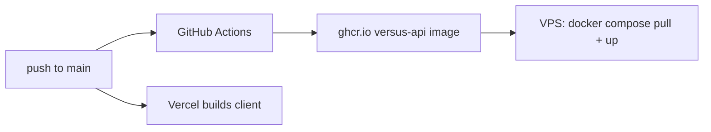

# Deployment



## Client (Vercel)

Vercel builds `client/` on push. Set `NEXT_PUBLIC_API_URI=https://versus-api.<domain>/api` in the project's environment variables.

## API (Docker on a VPS)

- **Image:** the root [`Dockerfile`](../Dockerfile) builds `versus-api`. The build context is the repo root, because the server needs the root lockfile and `shared/`.
  - The **build stage** runs `npm ci` for the server workspace, then bundles `server/src` to `server/dist/server.js` with esbuild.
  - The **runtime stage** (`node:22-alpine`, `NODE_ENV=production`) installs production dependencies only, copies `server/dist` and `server/seed`, runs as `node`, and starts with `node server/dist/server.js`.
  - `.dockerignore` leaves out `node_modules`, every `.env`, and all of `client/` except its `package.json`, which the workspace lockfile needs.
- **CI/CD:** [`.github/workflows/deploy.yml`](../.github/workflows/deploy.yml) builds the image, pushes it to GHCR as `versus-api:latest` and `versus-api:<commit sha>`, then SSHes into the VPS as `deploy` and runs `docker compose pull versus-api && docker compose up -d versus-api && docker image prune -f` in `~/app`. The Compose file lives on the VPS, not in this repo.
  - `docker image prune -f` removes dangling images, which stops old `:latest` layers from piling up on the VPS disk after each deploy. It runs only if the restart succeeded, and it applies to the whole Docker host, so it also clears other projects' dangling images on the shared VPS. Tagged and in-use images are kept.
  - It runs on push to `main` only when a file that goes into the image changes (`server/`, `shared/`, the root manifests and lockfile, `client/package.json`, `Dockerfile`, `.dockerignore`, or the workflow itself). Client-only and docs-only pushes don't redeploy the API. Run it by hand from the Actions tab (`workflow_dispatch`) to force a redeploy.
  - Repository secrets: `DEPLOY_HOST` (the VPS hostname or IP) and `DEPLOY_SSH_KEY` (a private ed25519 key whose public key is in the `deploy` user's `authorized_keys`). GHCR login uses the built-in `GITHUB_TOKEN`.
  - To roll back, point the Compose service at an older `versus-api:<sha>` tag and run `docker compose up -d versus-api` on the VPS. Compose pulls that tag from GHCR, because the prune step has already removed the old image from the VPS.
- **Compose on the VPS** (`~/app`, not in this repo):
  - The `versus-api` service runs `ghcr.io/<owner>/versus-api:latest`, and takes its restart policy, networks and memory limit from a shared `x-api` template.
  - Its `environment` sets `NODE_ENV=production`, `PORT=3000`, `NODE_OPTIONS=--max-old-space-size=192` and `MONGODB_URI`. `CORS_ORIGIN` comes from `env_file: ./env/versus.env`.
  - MongoDB 7 runs as a `mongo` service in the same file, on an internal `db` network, with a 512 MB limit and a 0.25 GB WiredTiger cache. The API has `depends_on: mongo: condition: service_healthy`, because the app exits if its first connection fails.
  - The app connects as a `versus` user with `authSource=versus`, which an init script in `./initdb/mongo` creates the first time the database starts empty.
- **TLS:** Caddy terminates TLS and proxies to the container, which serves plain HTTP.

### Build and run the image locally

```bash
docker build -t versus-api .
docker run --rm -p 3000:3000 \
  -e PORT=3000 -e MONGODB_URI=mongodb://host.docker.internal/localDB \
  -e CORS_ORIGIN=http://localhost:3000 versus-api
curl localhost:3000/health
```

## Constraints of the VPS

The VPS is a shared machine with 2 GB of RAM.

- **Memory:** the container is limited to 256 MB and runs with `--max-old-space-size=192`, both set in the Compose file (the image sets neither). Avoid large in-memory caches and loading whole datasets at once. Anything that needs more memory has to be planned first.
- **Nothing on local disk persists.** The VPS is periodically destroyed and recreated, which is why seeding runs automatically. Logs go to stdout and stderr only. Storing files would need external object storage.
- **Shutdown:** `docker stop` sends SIGTERM, and the server closes the Mongo connection and exits instead of waiting to be SIGKILLed after 10 s.

## Troubleshooting

| Symptom | Likely cause |
| --- | --- |
| The container exits right away with `MONGODB_URI is not set` or `CORS_ORIGIN must be set in production` | A variable is missing from the Compose environment |
| The container exits with `MongoDB initial connection error` | The database is unreachable at startup |
| The browser shows CORS errors | `CORS_ORIGIN` doesn't exactly match the Vercel origin (scheme and host, no trailing slash) |
| Every client call fails with a 404 or a JSON parse error | `NEXT_PUBLIC_API_URI` is missing its `/api` suffix |
| The home page says "There was an issue selecting fighters." | A default fighter ID is missing from the database (see [Data and seeding](data-and-seeding.md)) |
