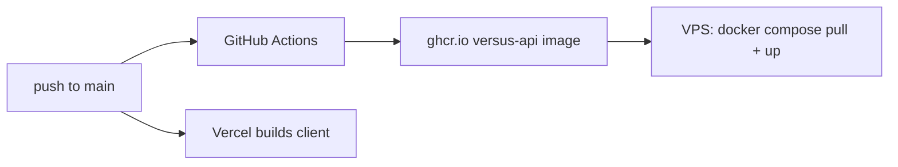

# Deployment



## Client (Vercel)

Vercel builds `client/` on push. Set `NEXT_PUBLIC_API_URI=https://versus-api.<domain>/api` in the project's environment variables.

## API (Docker on a VPS)

- **Image:** the root [`Dockerfile`](../Dockerfile) builds `versus-api`. The build context is the repo root, because the server needs the root lockfile and `shared/`.
  - The **build stage** runs `npm ci` for the server workspace, then bundles `server/src` to `server/dist/server.js` with esbuild.
  - The **runtime stage** (`node:22-alpine`, `NODE_ENV=production`) installs production dependencies only, copies `server/dist` and `server/seed`, runs as `node`, and starts with `node server/dist/server.js`.
  - `.dockerignore` leaves out `node_modules`, every `.env`, and all of `client/` except its `package.json`, which the workspace lockfile needs.
- **CI/CD:** on push to `main`, `.github/workflows/deploy.yml` builds and pushes the image to GHCR, then the VPS pulls it and restarts the container with Docker Compose. The workflow is managed outside this repo.
- **Runtime env (set by Compose):** `PORT=3000`, `MONGODB_URI`, `CORS_ORIGIN`, `NODE_ENV=production`.
- **TLS:** Caddy terminates TLS and proxies to the container, which serves plain HTTP.

### Build and run the image locally

```bash
docker build -t versus-api .
docker run --rm -p 3000:3000 \
  -e PORT=3000 -e MONGODB_URI=mongodb://host.docker.internal/localDB \
  -e CORS_ORIGIN=http://localhost:3000 versus-api
curl localhost:3000/health
```

## Constraints of the VPS

The VPS is a shared machine with 2 GB of RAM.

- **Memory:** the container is limited to 256 MB and runs with `--max-old-space-size=192`. Avoid large in-memory caches and loading whole datasets at once. Anything that needs more memory has to be planned first.
- **Nothing on local disk persists.** The VPS is periodically destroyed and recreated, which is why seeding runs automatically. Logs go to stdout and stderr only. Storing files would need external object storage.
- **Shutdown:** `docker stop` sends SIGTERM, and the server closes the Mongo connection and exits instead of waiting to be SIGKILLed after 10 s.

## Troubleshooting

| Symptom | Likely cause |
| --- | --- |
| The container exits right away with `MONGODB_URI is not set` or `CORS_ORIGIN must be set in production` | A variable is missing from the Compose environment |
| The container exits with `MongoDB initial connection error` | The database is unreachable at startup |
| The browser shows CORS errors | `CORS_ORIGIN` doesn't exactly match the Vercel origin (scheme and host, no trailing slash) |
| Every client call fails with a 404 or a JSON parse error | `NEXT_PUBLIC_API_URI` is missing its `/api` suffix |
| The home page says "There was an issue selecting fighters." | A default fighter ID is missing from the database (see [Data and seeding](data-and-seeding.md)) |
